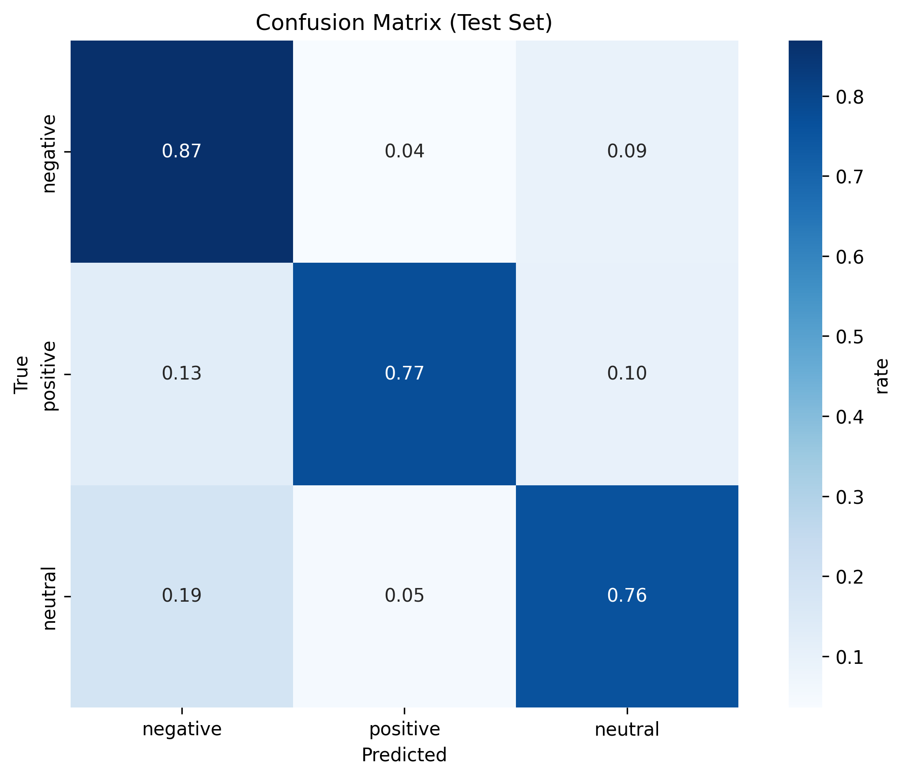
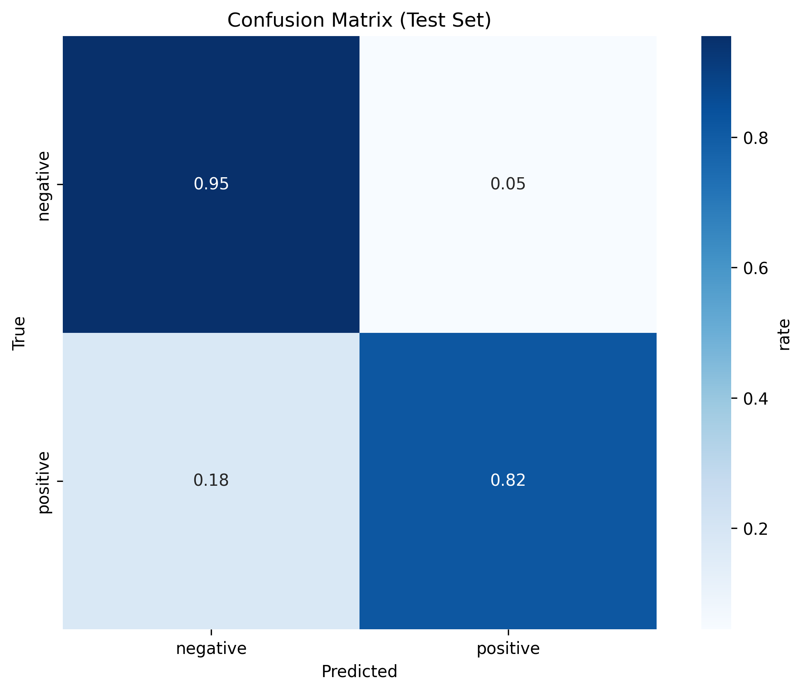
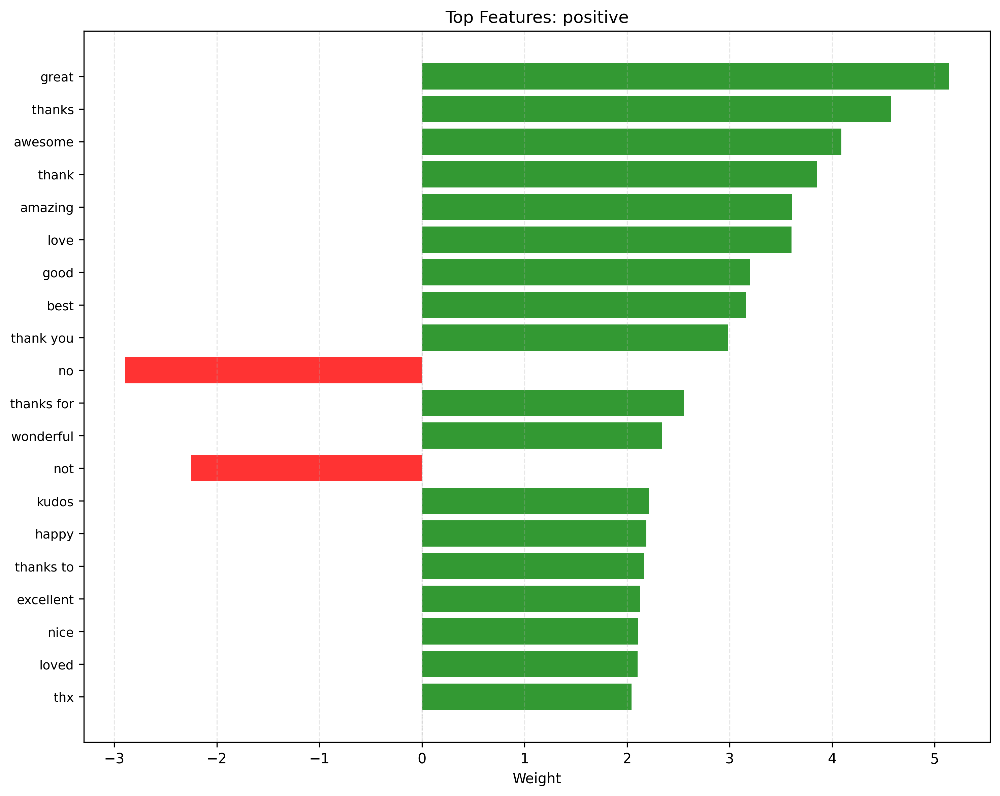
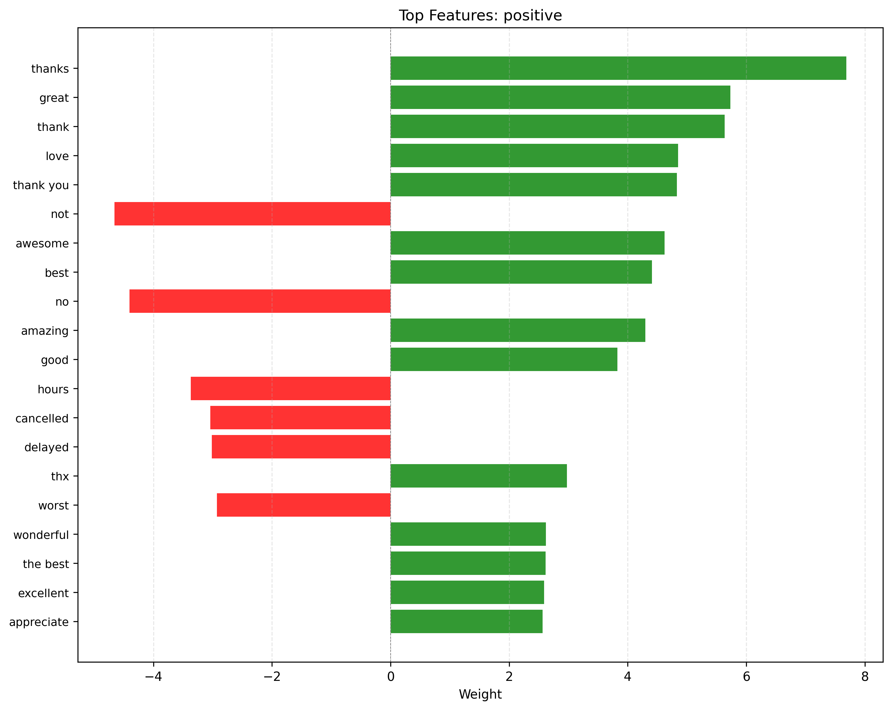
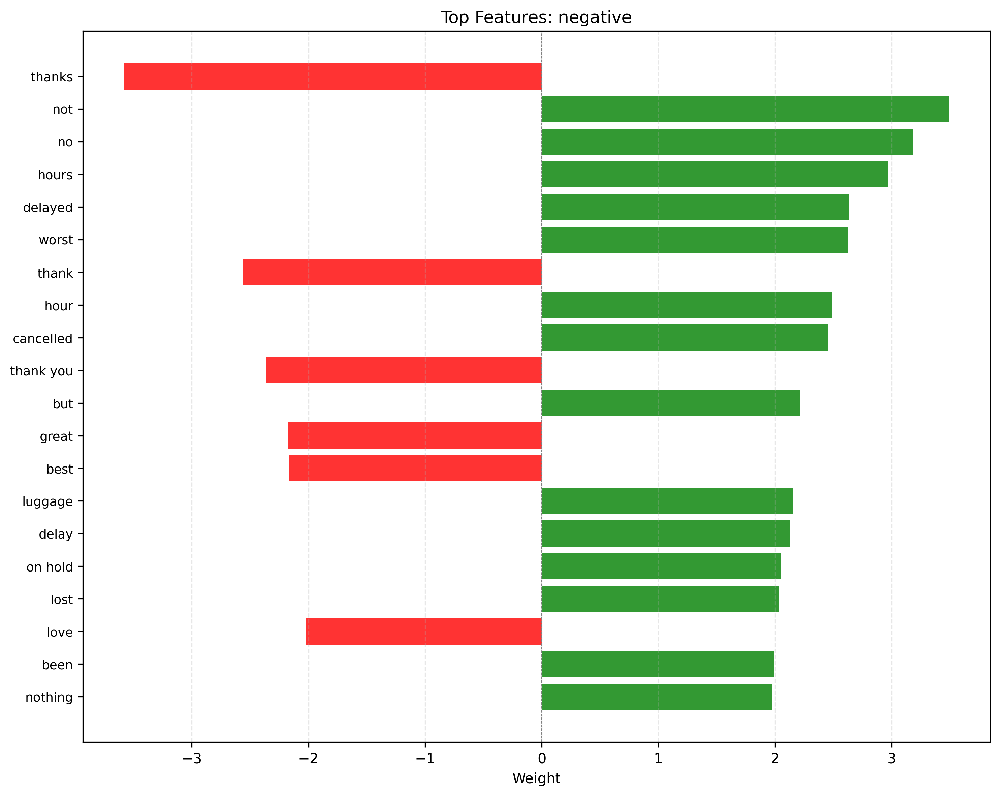
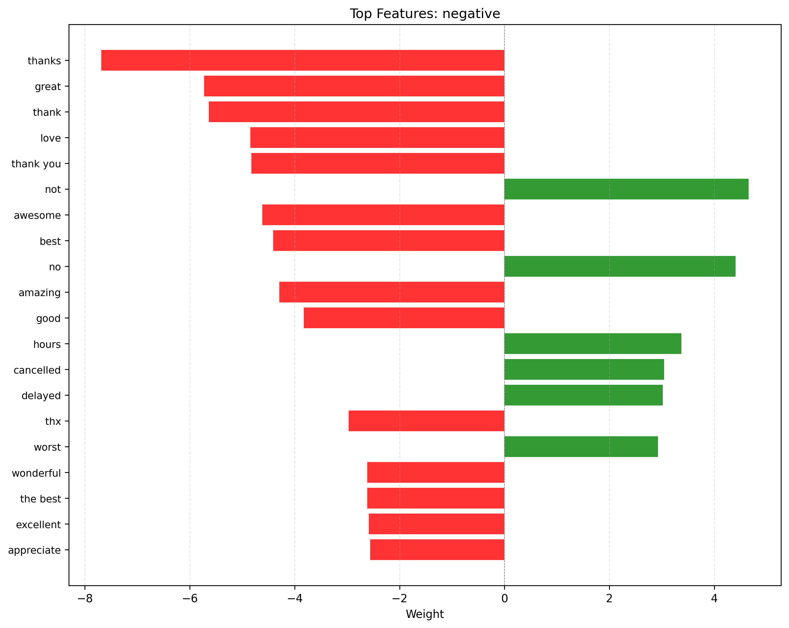
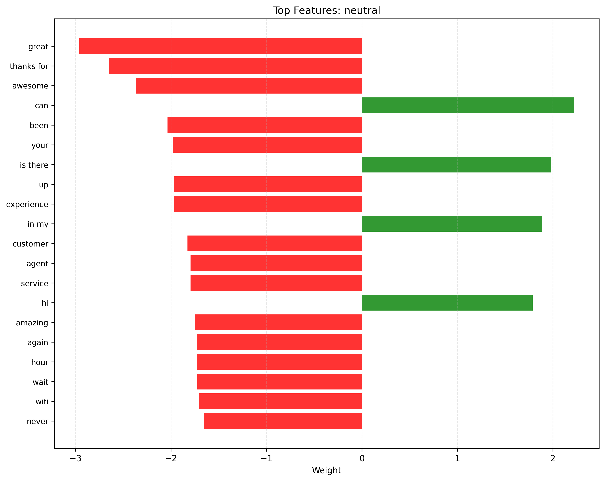

**[English Version / На английском](README.md)**

# Анализ тональности отзывов об авиакомпаниях в сети Twitter (X)

[](https://www.python.org/)
[](https://fastapi.tiangolo.com/)
[](https://streamlit.io/)
[](https://github.com/IlyaShaposhnikov/airline-sentiment-analysis/actions)
[](LICENSE)

Сквозной ML/NLP-пайплайн для предсказания тональности твитов об авиакомпаниях. Включает обучение с учетом уверенности разметчиков (confidence-aware), объяснимый ИИ, готовый к использованию в рабочей среде REST API, интерактивную панель управления и CI с комплексным тестированием.

## Обзор

Проект демонстрирует полный жизненный цикл машинного обучения: от загрузки и предобработки данных до обучения модели, оценки, интерпретации и промышленного развертывания. Построен с использованием современных практик Python, модульной архитектуры и строгого тестирования.

- **Датасет**: [Twitter US Airline Sentiment](https://www.kaggle.com/crowdflower/twitter-airline-sentiment) (с указанием уверенности аннотаций)
- **Модели**: TF-IDF или эмбеддинги предложений (Sentence-Transformers) × логистическая регрессия или MLP на PyTorch, везде со взвешиванием по уверенности аннотаций; включено воспроизводимое сравнение на нескольких seed
- **Интерпретируемость**: Веса модели + объяснения через SHAP (SHapley Additive exPlanations) — метод, который показывает вклад каждого слова в предсказание тональности на основе значений Шепли (опционально)
- **Развертывание**: FastAPI REST API + интерактивная панель на Streamlit
- **Качество**: Покрытие тестами >90% для основного ML-кода и сервисной логики, CI через GitHub Actions, аудит безопасности

## Возможности

| Категория | Ключевые особенности |
|-----------|---------------------|
| **Данные и предобработка** | Фильтрация по порогу уверенности, настраиваемая очистка (URL, упоминания, пунктуация), опциональная лемматизация, TF-IDF/Count векторизация; очистка встроена в векторизатор, поэтому при обучении и инференсе текст обрабатывается одинаково |
| **Обучение и оценка** | Обучение с весами по уверенности, стратифицированное разделение, комплексные метрики (F1, ROC-AUC, матрица ошибок), авто-экспорт в JSON/CSV, сравнение способов представления текста × классификаторов на нескольких seed |
| **Интерпретируемость** | Топ-слова с наибольшим вкладом по классам, объяснения для отдельных предсказаний, при отсутствии пакета SHAP используется резервный метод |
| **API и сервис** | Асинхронно-безопасные эндпоинты FastAPI, валидация через Pydantic v2, потокобезопасный сервис модели, CORS, обработка таймаутов |
| **Панель управления** | Интерфейс для одиночных и пакетных предсказаний, экспорт в CSV/JSON, проверка здоровья API в реальном времени, сохранение состояния сессии |
| **Тестирование и CI** | Юнит- и интеграционные тесты, условные воркфлоу для PR/main, pytest-timeout, проверка уязвимостей через pip-audit, интеграция с Codecov |

## Результаты и качество модели

### Сравнение подходов

Два способа представления текста × два классификатора, оценка с помощью `scripts/compare.py` на **5 стратифицированных разбиениях** (seed 42–46). Для каждого seed все четыре конфигурации используют одно и то же разбиение и одинаковые веса уверенности.

| Конфигурация | Accuracy | F1 (macro) | ROC-AUC | Задержка, мс/текст<br>(батч / одиночный) |
|---|---|---|---|---|
| **3 класса** | | | | |
| TF-IDF + LogReg | 0.843 ± 0.008 | 0.785 ± 0.011 | 0.938 ± 0.006 | 0.04 / 0.4 |
| TF-IDF + MLP | 0.845 ± 0.007 | 0.783 ± 0.010 | 0.938 ± 0.005 | 0.05 / 1.0 |
| Эмбеддинги + LogReg | **0.854 ± 0.004** | **0.805 ± 0.007** | 0.955 ± 0.005 | 5.5 / 14.9 |
| Эмбеддинги + MLP | 0.853 ± 0.006 | 0.804 ± 0.008 | **0.956 ± 0.004** | 5.3 / 17.2 |
| **Бинарный режим (positive / negative)** | | | | |
| TF-IDF + LogReg | 0.934 ± 0.005 | 0.888 ± 0.008 | 0.969 ± 0.006 | 0.04 / 0.3 |
| TF-IDF + MLP | 0.924 ± 0.004 | 0.875 ± 0.006 | 0.969 ± 0.003 | 0.07 / 0.8 |
| Эмбеддинги + LogReg | **0.949 ± 0.004** | **0.916 ± 0.006** | **0.986 ± 0.002** | 5.6 / 15.7 |
| Эмбеддинги + MLP | **0.949 ± 0.007** | **0.916 ± 0.010** | **0.986 ± 0.002** | 5.0 / 14.9 |

*Среднее ± стандартное отклонение по seed. TF-IDF: 2000 униграмм/биграмм, словарь строится только на обучающей части; эмбеддинги: `all-MiniLM-L6-v2` (384 измерения, замороженная модель); MLP: один скрытый слой из 128 нейронов с ранней остановкой. Задержка измерена от сырого текста до предсказания на CPU ноутбука.*

**Выводы**

- **Представление текста важнее классификатора.** Эмбеддинги улучшают все метрики по сравнению с TF-IDF при любом классификаторе: +2.0 п.п. macro-F1 для 3 классов, +2.8 п.п. в бинарном режиме, +0.017 ROC-AUC в обоих — это два-три стандартных отклонения, стабильно на всех seed.
- **Нелинейный классификатор здесь ничего не добавляет.** MLP на эмбеддингах повторяет результат логистической регрессии, а на TF-IDF не лучше неё (в бинарном режиме — хуже). С хорошими признаками достаточно линейной модели.
- **У качества есть цена.** Эмбеддинги примерно в 40 раз медленнее на одиночном запросе (≈15 мс против 0.4 мс) и более чем в 100 раз в батче, требуют torch и модель на 90 МБ и лишают пословных объяснений.
- **Практический выбор:** TF-IDF + LogReg остаётся моделью по умолчанию — быстрая, лёгкая, объяснимая. Эмбеддинги + LogReg — когда качество важнее задержки и интерпретируемости.

Воспроизвести: `python scripts/compare.py` (и с `--binary-mode`). Эмбеддинги кодируются один раз и кэшируются.

### Базовая модель подробно (TF-IDF + LogReg)

| | Multiclass (3 класса) | Binary (positive/negative) |
|---------|----------------------|--------------------------|
| **Матрица ошибок** |  |  |
| **Positive признаки** |  |  |
| **Negative признаки** |  |  |
| **Neutral признаки** |  | *N/A* |

> 💡 **Примечания**:
> - Графики построены для разбиения с `random_state=42` (25% — отложенная тестовая выборка) из 10 768 твитов с уверенностью разметки ≥ 0.7; метрики этой модели — в строках TF-IDF + LogReg выше
> - Binary режим исключает нейтральный класс (target=2), фокусируясь исключительно на позитивных/негативных сигналах
> - Важность признаков показывает топ-20 слов по весовому коэффициенту логистической регрессии
> - Матрицы ошибок нормализованы (по строкам) для объективного сравнения классов

## Структура проекта

```
airline-sentiment-analysis/
├── configs/
│   ├── config.yaml              # Централизованная конфигурация (вложенная, валидируемая)
│   └── CONFIG_GUIDE.md          # Подробный справочник по параметрам конфига, валидации и переменным окружения
├── data/
│   ├── Tweets.csv               # Исходный датасет (загружается пользователем)
│   └── DATA_GUIDE.md            # Документация датасета
├── docs/images/                 # Визуализации результатов модели (multiclass/binary)
├── src/
│   ├── constants.py             # Глобальные константы: маппинг целевых меток, пути, значения по умолчанию
│   ├── data_loader.py           # Загрузка данных и фильтрация по уверенности
│   ├── preprocessing.py         # Очистка текста, лемматизация, векторизация
│   ├── embeddings.py            # Эмбеддинги Sentence-Transformers как векторизатор в стиле sklearn (опционально)
│   ├── models.py                # Обучение, оценка, сохранение моделей
│   ├── torch_models.py          # MLP-классификатор на PyTorch с API в стиле sklearn (опционально)
│   ├── metrics.py               # Вычисление метрик и отчетность
│   ├── interpretability.py      # Объяснения через веса модели / SHAP
│   ├── api/                     # Сервисный слой FastAPI
│   │   ├── config.py            # Настройки API и переопределения через env-переменные
│   │   ├── models.py            # Схемы запросов/ответов Pydantic
│   │   ├── services.py          # Потокобезопасный ModelService
│   │   ├── main.py              # Точка входа FastAPI и маршруты
│   │   └── API_REFERENCE.md     # Технический справочник по эндпоинтам, схемам Pydantic и обработке ошибок
│   ├── utils/logging_config.py  # Централизованная настройка логирования
│   └── dashboard.py             # Веб-интерфейс на Streamlit
├── scripts/
│   ├── train.py                 # CLI-пайплайн обучения
│   ├── predict.py               # CLI-инференс и пакетный экспорт
│   └── compare.py               # Сравнение TF-IDF/эмбеддинги x LogReg/MLP на нескольких seed
├── tests/
│   ├── conftest.py              # Общие фикстуры pytest, маркеры, глобальная конфигурация тестов
│   ├── test_torch_models.py     # Обучение MLP, ранняя остановка, сохранение, пайплайн и API
│   ├── test_shap_lazy_import.py # shap импортируется только при запросе SHAP-объяснений
│   ├── test_api_model_info.py   # Метаданные модели в ModelService и /health
│   ├── test_compare.py          # Скрипт сравнения: выходные файлы, кэш эмбеддингов, бинарный режим
│   ├── test_metrics.py          # Определения метрик (macro F1 в бинарном режиме)
│   ├── test_runtime.py          # Обход конфликта OpenMP torch/scikit-learn на Windows и порядок импортов
│   ├── test_embeddings.py       # Векторизатор эмбеддингов, пайплайн и API (фейковый энкодер, без скачивания)
│   ├── test_data_loader.py      # Юнит-тесты разбиения train/test (согласованность строк, стратификация)
│   ├── test_preprocessing.py    # Юнит-тесты очистки текста, токенизации, векторизации
│   ├── test_ml_models.py        # Юнит-тесты обучения, оценки, сохранения моделей
│   ├── test_api_models.py       # Юнит-тесты схем Pydantic: валидация, сериализация, ограничения
│   ├── test_api_services.py     # Юнит-тесты ModelService: асинхронность, потокобезопасность, обработка ошибок
│   ├── test_integration.py      # Сквозные тесты пайплайна: config → data → model → API
│   └── test_train_pipeline.py   # Регрессионные тесты артефактов scripts/train.py (без утечки, согласованные отчеты)
├── pytest.ini                   # Конфигурация pytest: маркеры, фильтры, режим asyncio, опции по умолчанию
├── .github/workflows/test.yml   # CI-пайплайн
├── .gitignore                   # Шаблоны игнорирования для Git
├── README.md                    # Документация проекта (английский)
├── README.ru.md                 # Документация проекта (русский)
├── requirements.txt             # Зависимости проекта
└── requirements-dl.txt          # Опциональные DL-зависимости (torch, sentence-transformers)
```

## Быстрый старт

### 1. Настройка окружения
```bash
git clone https://github.com/IlyaShaposhnikov/airline-sentiment-analysis.git
cd airline-sentiment-analysis

python -m venv .venv
source .venv/bin/activate  # Windows: .venv\Scripts\activate

pip install -r requirements.txt
```

### 2. Подготовка данных
Скачайте `Tweets.csv` с [Kaggle](https://www.kaggle.com/crowdflower/twitter-airline-sentiment) и поместите в директорию `data/`:
```
data/
└── Tweets.csv
```

### 3. Обучение модели
```bash
python scripts/train.py
# Опциональные флаги:
# --binary-mode            # Обучать только на 2 классах: positive/negative
# --no-plots               # Пропустить генерацию визуализаций
# --explain --n-explain 5  # Сгенерировать объяснения предсказаний
```
Артефакты будут сохранены в `artifacts/` (пакет модели, метрики, графики, логи).

**Опционально: эмбеддинги предложений вместо TF-IDF.** Тексты кодируются предобученной моделью [Sentence-Transformers](https://www.sbert.net/) (по умолчанию `all-MiniLM-L6-v2`, см. `preprocessing.embedding` в конфиге) и классифицируются той же логистической регрессией:
```bash
pip install torch --index-url https://download.pytorch.org/whl/cpu  # сборка только для CPU
pip install -r requirements-dl.txt
python scripts/train.py --vectorizer sentence_embedding --output-dir artifacts/embedding_lr
```
Модель скачивается один раз (~90 МБ) в кэш Hugging Face.

**Опционально: MLP на PyTorch вместо логистической регрессии** (работает с обоими типами признаков; настройки в `model.mlp`, ранняя остановка по валидационной части обучающей выборки):
```bash
python scripts/train.py --model mlp --output-dir artifacts/tfidf_mlp
python scripts/train.py --model mlp --vectorizer sentence_embedding --output-dir artifacts/embedding_mlp
```
Пословные объяснения и графики важности признаков требуют TF-IDF-признаков **и** линейной модели; для эмбеддингов или MLP API возвращает предсказания с `explanation: null`. Чтобы запустить API с другой моделью, укажите путь к её бандлу: `MODEL_PATH=artifacts/embedding_mlp/model_bundle.joblib uvicorn src.api.main:app`.

### 4. Запуск REST API
```bash
uvicorn src.api.main:app --host 0.0.0.0 --port 8000 --reload
```
Интерактивная документация: http://localhost:8000/docs

### 5. Запуск панели управления
```bash
streamlit run src/dashboard.py
```
Интерфейс откроется по адресу: http://localhost:8501

## Конфигурация

Все настройки задаются в `configs/config.yaml`. Ключевые секции:

```yaml
data:
  confidence_threshold: 0.7  # Фильтровать аннотации с низкой уверенностью

preprocessing:
  vectorizer: { type: "tfidf", max_features: 2000, ngram_range: [1, 2] }
  cleaning: { remove_urls: true, remove_mentions: true, remove_special_chars: true }

model:
  training: { max_iter: 500, class_weight: "balanced", use_confidence_weights: true }
  regularization: { solver: "lbfgs", penalty: "l2", C: 1.0 }

serving:
  api: { enabled: true, port: 8000, limits: { max_text_length: 1000, max_batch_size: 100 } }
  dashboard: { enabled: false, title: "Airline Sentiment Predictor" }
```
> 💡 API и панель управления читают из окружения `MODEL_PATH`, `CORS_ORIGINS` и `API_LOG_LEVEL`; для обучения используются флаги CLI (`--model`, `--vectorizer`, `--seed`, `--binary-mode`). Подробнее — `configs/CONFIG_GUIDE.md`.

## Тестирование и CI

### Локальные тесты
```bash
# Запустить полный пакет тестов
pytest tests/ -v --cov=src --cov-report=term-missing

# Быстрый режим для PR (пропустить интеграционные тесты)
pytest tests/ -v -m "not integration"
```

### CI-пайплайн
Автоматически запускается при `push` и `pull_request`:
- Тесты на Python 3.10, 3.11, 3.12
- Быстрый режим для PR, полный режим для `main`/`develop`
- Сканирование уязвимостей через `pip-audit`
- Покрытие загружается в Codecov + артефакты GitHub
- Защита от зависаний и отмена дублирующих запусков

## Использование API

```bash
# Одиночное предсказание
curl -X POST http://localhost:8000/predict \
  -H "Content-Type: application/json" \
  -d '{"text": "Great flight, excellent service!", "explain": true}'

# Пакетное предсказание
curl -X POST http://localhost:8000/predict/batch \
  -H "Content-Type: application/json" \
  -d '{"texts": ["Amazing!", "Terrible delay", "Meh"], "explain": false}'

# Проверка состояния: также показывает, какая модель загружена и умеет ли она объяснять
curl http://localhost:8000/health
# {"status": "healthy", "model_loaded": true, "model_type": "LogisticRegression",
#  "vectorizer_type": "TfidfVectorizer", "explanations_supported": true, ...}
```
Модели без пословных объяснений (эмбеддинги, MLP) возвращают `"explanation": null` даже при `"explain": true`; в панели управления чекбокс объяснений для них неактивен.

---

## Решение проблем

**Windows: `Windows fatal exception: access violation` при кодировании эмбеддингов.**
Редкое недетерминированное падение в нативном коде torch (наблюдалось с torch 2.14 CPU на Windows). В проекте уже применено смягчение (см. `src/__init__.py`). Если падение всё же произошло — перезапустите команду или запустите с одним потоком OpenMP (надёжно, кодирование примерно в 2 раза медленнее):
```bash
OMP_NUM_THREADS=1 python scripts/train.py --vectorizer sentence_embedding
```

## Зависимости

| Категория | Пакеты |
|-----------|--------|
| Основные | `numpy`, `pandas`, `scikit-learn`, `scipy` |
| NLP | `nltk`, `shap` (опционально) |
| API | `fastapi`, `uvicorn`, `pydantic>=2` |
| Интерфейс | `streamlit`, `matplotlib`, `seaborn` |
| Глубокое обучение (опционально) | `torch`, `sentence-transformers` |
| Тестирование | `pytest`, `pytest-cov`, `pytest-asyncio`, `pytest-timeout`, `pip-audit` |

## Автор

Илья Шапошников | [E-mail](mailto:ilia.a.shaposhnikov@gmail.com) | [LinkedIn](https://linkedin.com/in/iliashaposhnikov)

**[English Version / На английском](README.md)**
